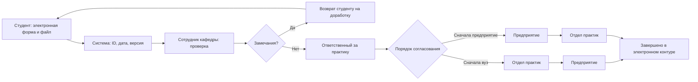

# Цифра · Карта процесса «как будет» (TO-BE)

**Объект:** оформление договора производственной практики. **Единственная ключевая функция MVP:** электронная подача договора на предварительную проверку с фиксацией времени, статуса и версий.

## Процесс AS-IS — фактическая проблема

1. Студент получает шаблон и оформляет бумажный договор.
2. Передаёт документ сотруднику/ответственному при очном посещении.
3. Документы собираются пачками; время до следующего приёма может составлять дни или недели.
4. Бумага передаётся по цепочке согласования; студент не видит, у кого находится экземпляр.
5. При возврате или потере документ оформляется и передаётся повторно.
6. Предприятие и университет согласовывают в установленном порядке, который может различаться.

*Источник*: интервью ответственных сотрудников и обезличенная таблица наблюдений. Не все показатели являются документально подтверждёнными.

## TO-BE — в работающем MVP

**Что изменено MVP:** необходимость очной передачи на этапе *предварительной проверки* заменена электронным вводом и защищённой загрузкой документа. Время каждого действия сохраняется. Право на подтверждение каждого этапа установлено сервером.

**Что ещё не изменено:** юридически значимое подписание, взаимодействие с Directum RX и внешними удостоверяющими центрами, согласование внутренних приказов, банк курсовых работ. Кнопка «Подтвердить» не является УКЭП.

## Контроль эффекта

- **Основная метрика MVP:** время между электронной подачей на предварительную проверку и результатом этой проверки.
- **События:** `submitted_at` → `staff_approved_at` (или событие `return`).
- **Остальные метрики:** число повторных передач, число версий, частота возвратов, время всего маршрута, просрочки.
- **Для сравнения:** в «до» требуются те же стартовая и конечная точки, рабочие/календарные единицы времени и сопоставимые виды практики. Средние 23,95 дня полного исходного маршрута нельзя напрямую сравнивать со временем только предварительной проверки в MVP.